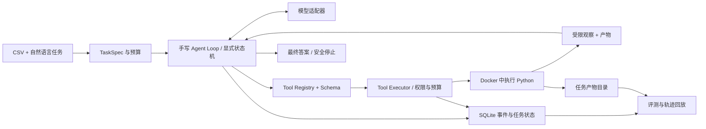

# Project 2：SandMind——可恢复的数据分析 Agent（正式规划 v3）

> 目标：服务 AI Agent 应用开发方向的日常实习求职；单人开发，3～4 周完成主要版本。
> 状态：在原 Harness 方案审查后修订。所有效果、成本和安全结论以实际测试为准。
> 与 RepoMind 的关系：RepoMind 解决固定版本代码的检索与引用；SandMind 解决有状态的工具执行、受限环境与失败恢复。两个项目不共享业务代码，也不重复做 RAG。

## 0. 选型结论与项目定位

SandMind 是一个**完成真实数据分析任务的 Agent 应用**，Harness 是让它可靠运行的工程手段。用户提供一个 CSV 文件和自然语言问题，Agent 查看数据、生成并调用 Python 分析代码，经过多轮观察与修正，输出可核查的数值结论和可选图表。系统记录完整轨迹，并在失败或中断后安全地继续或停止。

与仅调用一次框架 `create_agent()` 的 Demo 相比，本项目自行实现一次完整工具调用循环、执行状态与预算控制、错误分类、持久化与恢复判定。最终价值由**可运行演示、故障注入结果和固定任务上的对照实验**证明，不由框架数量证明。

数据分析是合适的负载：CSV 输入明确，Python 工具调用真实，数值答案可用确定性规则评分。但 MVP 只支持单个本地 CSV、清洗、统计、简单计算及可选单图；不承诺任意复杂数据科学任务、外部 API 查询或自动安装依赖。若结束时无法稳定完成这些任务，应先修复业务闭环，而不是继续扩展 Harness。

## 1. MVP、交付物与非目标

### MVP 必须完成

1. CLI 接收一个 CSV、一个明确的分析问题，并创建独立 `task_id`。
2. 手写 Agent Loop：模型提出工具调用 → Schema/权限校验 → 受限执行 → 返回观察 → 模型继续或完成；有总步数、模型调用数、token 和墙钟时间上限。
3. 两个工具：`inspect_data` 返回列名、类型、行数与有限样例；`run_python` 执行分析代码并返回受限的 stdout、stderr、退出状态及产物清单。
4. Docker 执行环境：只读数据、受限产物目录、关闭网络、资源/时间/输出限制；模型代码不在宿主机直接运行。
5. SQLite 任务与工具事件日志、任务产物目录；中断后能够安全恢复已确定状态，或明确报告不能自动恢复。
6. 最终输出数值答案和使用的产物信息；可选一张图；保存可查看的逐步轨迹。
7. 小型固定任务集、故障注入测试和至少一组公平对照实验。

**交付物**：可运行 CLI、固定示例数据与任务、最小测试、事件轨迹、评测脚本、原始实验结果、README、架构图和演示。若时间不足，先保证端到端闭环、受限执行、恢复与可复跑评测；图表与界面可以推迟。

### 推迟或删除的工作

| 决定 | 内容 | 进入项目的条件 |
|---|---|---|
| 推迟 | LangGraph 实现 | 手写 Loop 完成后，确有复杂分支或持久化收益，再做一个小型对照实现；不重写主业务。 |
| 推迟 | LLM 结构化摘要 | 测试任务确实触发上下文预算，且简单策略有可解释的不足。 |
| 推迟 | Langfuse 接入 | 本地轨迹无法有效定位延迟或错误时接入；自托管不列入四周计划。 |
| 推迟 | 模型路由与缓存优化 | 单模型基线、用量和成本记录稳定后，再验证实际收益。 |
| 推迟 | vLLM、microVM、CubeSandbox | 有明确模型部署或更强隔离需求与可用资源时再评估。 |
| 删除 MVP | Redis、分布式队列、通用插件/权限引擎、kernel 状态快照、全量 Benchmark、多 Agent 协作 | 当前单机、单人、单任务闭环不需要这些组件。 |

## 2. 用户流程与架构

`TaskSpec` 保存原始问题、输入 CSV 的标识与哈希、允许的输出目录、输出要求和预算。它是不可变的任务约束，不由上下文摘要改写。任务数据和产物只在该任务范围内可见。运行时固定模型 ID、容器镜像版本和工具 Schema 版本，便于重放与评测。

| 模块 | 职责 | 实现选择 |
|---|---|---|
| Model Adapter | 统一工具调用消息和 token 用量；屏蔽模型 API 差异。 | 使用现成 SDK，接口自己定义。 |
| Agent Loop | 驱动状态转换、预算、继续/结束/停止。 | 自己实现。 |
| Tool Registry / Schema | 登记允许的工具、参数、输出结构和版本。 | 契约自己设计，参数校验可用成熟库。 |
| Tool Executor | 校验权限、分配调用 ID、执行、限时、分类错误、记录结果。 | 策略自己实现，容器能力用 Docker。 |
| Context Builder | 装配不可变约束、已确认事实与必要观察。 | 自己实现并记录输入 token。 |
| Event Store / Artifacts | 记录任务、调用状态、结果引用、文件清单与哈希。 | SQLite + 本地目录；不需要 Redis。 |
| Evaluator | 按工具、轨迹和结果三层评分，输出逐题记录。 | 评分规则自己实现。 |

## 3. Agent Loop 与工具执行契约

### 状态与停止条件

建议状态：`CREATED → WAITING_FOR_MODEL → TOOL_PROPOSED → APPROVAL/EXECUTING → OBSERVED → WAITING_FOR_MODEL`，结束状态为 `COMPLETED / FAILED / CANCELLED / NEEDS_REVIEW`。每次转换写入事件；禁止从未知执行结果直接跳回“可重试”。任务超过任何预算时停止并给出原因。没有工具调用的模型回复只有通过最终答案校验后才算完成。

Tool Registry 只暴露 `inspect_data` 和 `run_python`。Schema 在执行前检查参数类型、大小和允许的文件标识。Tool Executor 不拼接来自模型的 shell 命令；模型提供 Python 代码，执行器负责固定运行方式和隔离配置。每个工具调用都有唯一 `call_id`，同一请求重复送达不能创建两个有效结果。

### 错误分类与处理

| 类型 | 例子 | 处理 |
|---|---|---|
| 参数/Schema 错误 | 参数缺失、代码过长、非法文件标识 | 不执行；向模型返回精简错误，最多有限次修正。 |
| 代码/数据错误 | Python 语法错误、列不存在、数据类型不符 | 记录受限 stderr，允许模型修正代码；计入步骤预算。 |
| 临时基础设施错误 | 容器启动失败、模型 API 短暂不可用 | 在独立的基础设施重试预算内重试；不让模型盲改代码。 |
| 权限/资源拒绝 | 越权路径、网络访问、内存或时间上限 | 拒绝或终止该调用；默认不自动扩权。 |
| 结果未知 | 进程中断时工具可能已写产物 | 先核对调用记录与产物完成标记；无法确定时进入 `NEEDS_REVIEW`，不盲目重跑。 |

每类重试上限、总工具步数、总模型调用次数、总 token 和总运行时间由配置记录。Hooks 在 MVP 只承担执行前校验与执行后记录，不构建通用插件系统。

## 4. Sandbox、权限与安全边界

开发早期可用固定可信脚本验证容器 I/O；**模型生成的 Python 进入正式演示前必须通过受限执行器**。MVP 采用每次工具调用一个新进程或新容器，输入 CSV 只读、产物显式写入任务目录。模型不能依赖持久 kernel 内的变量；跨步信息通过文件、结果和工具观察传递。这使恢复和重复执行语义可检查。

容器配置至少包括：固定镜像与预装依赖、非 root 用户、只读根文件系统、输入数据只读挂载、仅任务产物目录可写、关闭网络、丢弃不需要的 capabilities、禁止提权、限制 CPU/内存/进程数、墙钟超时、stdout/stderr 和产物大小上限。绝不挂载 Docker socket、宿主机密钥或任意用户目录。执行结束记录退出码、资源终止原因和产物哈希；超时终止整个执行单元。

**Docker 降低风险，不提供绝对安全隔离**：它共享宿主内核，错误挂载、运行时漏洞或资源配置不当仍可能影响主机。MVP 是单人本地受控实验，不承诺面向任意不可信公众上传代码的生产级多租户安全。WSL2 环境先检查 Docker 可用性及资源限制；绑定数据和产物时优先使用 WSL Linux 文件系统，避免 Windows 挂载路径带来的性能与事件问题。

权限在任务启动时确定：允许读取这份 CSV、允许写入这一个产物目录、允许执行受限 Python、执行预算是多少。超出范围的操作默认拒绝；未来若加入网络或其他文件访问，再设计显式用户审批。不得用模型自行批准自身请求。

## 5. 状态持久化与恢复

区分三层状态：

1. **对话/决策状态**：原始任务、模型消息、已确认事实、当前阶段和预算剩余量。
2. **工具执行状态**：`call_id`、工具/参数摘要、审批结果、开始与结束时间、退出码、错误类别、结果引用。
3. **运行环境状态**：CSV 哈希、镜像版本、产物清单与哈希；不保存内存中的 Python kernel 变量。

每次工具调用先持久化 `started`，结束后持久化 `succeeded/failed` 及结果引用。中断恢复时读取最后一条事件：已完成调用只回放结果，不再次执行；未开始调用可继续；`started` 但无完成事件的调用先检查其专属临时目录、完成标记和产物哈希。若无法确认是否执行完成，安全停止并要求人工判断。

`inspect_data` 属于只读操作，可在故障后重试。`run_python` 只允许写该 `call_id` 的临时产物目录，成功后再将产物登记为任务结果；重试时必须核对是否已有成功结果。容器镜像、CSV 和已登记产物应保持可读取。SQLite 与产物文件不能假定共享事务，因此需要完成标记与启动时一致性检查。**MVP 不需要 kernel 快照、state-diff 或通用分布式 checkpoint。**

## 6. Context Engineering、观测与成本

### 上下文管理

所有实验组共用工具输出整理：结构化返回列名、行数、统计量和有限错误；截断过长 stdout/stderr，去重重复观察；原始完整输出保存在本地轨迹。不可变 `TaskSpec` 始终保留，已确认的关键数值带来源记录。触发条件使用实际 token 预算与安全余量，不预设通用的 70–80% 阈值。

第一组上下文实验只比较：

- **Baseline**：在相同预算内保留完整历史；超限按固定规则停止。
- **改进组**：保留 `TaskSpec`、已确认事实及最近观察，较旧观察按确定性规则压缩。

仅当任务确实触发压缩、且确定性策略不足时，加入 LLM 结构化摘要。摘要输出必须包含任务约束、已完成分析、关键数值及其来源、待解决问题；校验约束字段与已确认数值是否丢失。模型“复述约束”可辅助检查，不能单独证明压缩无损。报告压缩触发次数、输入 token、成功数、成本及被压缩改变结果的题目，不预设压缩必然改善成功率。

### 可观测性与预算顺序

第 1 周记录本地 JSON/SQLite 轨迹：每轮模型输入/输出摘要、工具调用、状态转换、token、延迟与错误。第 2 周补齐按步骤聚合的成本与故障原因。若本地轨迹不足以排查问题，再接 Langfuse SDK；不为展示技术栈而自托管其完整服务。先使用一个固定模型建立基线，模型路由与缓存收益待有稳定任务集后再测试。API 价格和缓存行为实施时核对官方资料；项目只报告实际用量与实付口径。

## 7. 评测协议与最小实验

### 任务集

使用两套互补任务：

- **答案集**：从 InfiAgent-DABench 的公开验证集选 12–20 道符合单 CSV、固定依赖范围的题；固定题号、数据文件哈希、标签及评测脚本版本。另自建 6–8 道题，覆盖清洗、多步统计、简单图表和明确约束。
- **故障集**：在固定任务上注入语法错误、超时、越权路径、工具执行中断、产物已写但完成事件未提交等情况，用于测试 Harness 行为；不混入 DABench 答题准确率。

DABench 官方提供公开验证集、CSV、标签和闭式答案评分脚本，但只公开验证集，公开标签有潜在污染风险。其原评测允许模型格式重排；本项目分别报告**原始格式通过率、原始答案正确率、重排后的答案正确率**（如使用重排），并把重排成本计入。Hugging Face 页面在线预览目前有 CSV 异构列导致的转换错误；下载原始文件、固定版本并先验证选中题目的文件和标签可读取。DABench 分数只作为项目内部对照，不宣称 SOTA。

### 三层指标

| 层次 | 指标与证据 |
|---|---|
| 工具层 | Schema 拒绝是否正确、权限阻断数、超时/资源终止数、错误分类正确数与重试决定。 |
| 轨迹层 | 步数、工具调用数、预算超限停止、重复执行数、中断后可恢复任务数、关键约束保留数。 |
| 结果层 | 数值答案按预设格式与容差比较；图表验证产物及关键数据范围，必要时人工复核。 |
| 成本与时延 | 每任务输入/输出 token、实际费用、模型耗时、容器耗时、总墙钟时间；缓存命中单列。 |

### 最小可行对照实验

固定 12–20 道题、同一模型/参数、镜像、工具 Schema、输出整理、任务预算和评分器，对比“完整历史”与“不可变任务约束 + 最近观察 + 旧观察确定性压缩”。逐题记录是否真正触发压缩；全体题和触发子集分别报告。先各跑一遍生成失败清单；费用允许再进行配对重复运行。一次随机差异不写成稳定提升。开发题用于调 prompt 和预算，锁定测试题只用于最终报告；答案文件不得进入 Agent 可读目录。

中断恢复另做确定性实验：在调用前、调用中、产物写入后但完成事件写入前注入中断，比较恢复后的产物和轨迹，检查是否重复执行或错误覆盖。所有实验保存逐题原始结果、模型版本、配置、日期及失败分类。简历数字只从实际结果计算。

## 8. 三个核心技术亮点与面试准备

| 亮点 | 要解决的问题、方案与选择依据 | 可量化指标 | 主要难点 / 面试追问 |
|---|---|---|---|
| 可靠工具调用循环 | 手写状态机、Schema、错误分类、重试与预算，使每步行为可解释。 | 任务完成数、错误分类正确数、平均步骤、预算终止数。 | 超时后如何知道代码是否执行？模型错误与基础设施错误为何不同处理？ |
| 受限执行与可恢复产物 | Docker 固定镜像、输入只读、调用 ID 专属产物及事件日志；以显式文件替代 kernel 快照。 | 越权阻断、超时终止、恢复成功数、重复执行数、产物一致性。 | Docker 的隔离边界是什么？SQLite 与产物非原子时如何恢复？ |
| 可验证上下文管理 | 不可变任务约束、结构化观察和确定性旧历史压缩；解决长任务成本与信息丢失。 | 触发题数、输入 token、成功数、约束保留数、实际成本。 | 节省 token 是否牺牲成功率？如何保证对照只改变上下文策略？ |

第三项能否成为简历主亮点取决于实验：若任务太短或没有可解释收益，以中断恢复作为更强的主亮点。如实展示失败案例比预设漂亮分数更有说服力。

## 9. 3～4 周开发计划

### 第 1 周：Walking Skeleton

**阶段目标与知识点**：理解模型工具消息协议、最小循环和停止条件，尽早得到真实业务结果。

- 模块与任务：定义 `TaskSpec`、两个工具 Schema 和最小 CLI；接入一个模型；手写“模型 → 工具 → 观察 → 继续/完成”循环；用固定可信 Python 代码先验证 Docker I/O，再接模型生成代码。
- 可运行交付：一个 CSV 问题经过多轮工具调用得到可手工核对的数值答案，保存每轮轨迹。
- 测试与验收：至少 2–3 道简单题；无效参数、模型未调用工具、单次工具超时都能明确结束或修正。
- 预计难点：工具调用消息格式、容器输入输出与数据路径映射。
- **自己实现** Loop、工具契约、步骤预算；**可依赖**模型 SDK、Docker、pandas 和参数校验库。

### 第 2 周：可靠工具执行

**阶段目标与知识点**：理解显式状态机、错误分类、最小权限和执行资源限制。

- 模块与任务：拆分 Registry、Schema、Executor；加入执行前校验、执行后记录、错误分类与有限重试；固定输入/产物目录权限，实施 CPU、内存、时间和输出上限。
- 可运行交付：成功轨迹与几种失败轨迹均可查看，每次调用有唯一 ID 和明确终止原因。
- 测试与验收：注入语法错误、缺失列、越权路径、超时和资源超限；检查状态、错误类别、重试次数及无越权产物。
- 预计难点：区分代码错误与执行器错误；处理执行已开始但结果未知。
- **自己实现**状态转换、错误策略和事件格式；**可依赖**Docker 限制能力及 SQLite 驱动。

### 第 3 周：恢复与上下文

**阶段目标与知识点**：理解事件持久化、幂等性、产物一致性和 token 预算。

- 模块与任务：持久化任务与工具事件；建立每个 `call_id` 的产物临时目录和完成标记；实现恢复判定；加入共同的工具输出整理与一项确定性上下文压缩策略。
- 可运行交付：进程重启后能继续已确认状态，或在不确定时安全停止；可展示压缩前后的模型输入。
- 测试与验收：在调用前后及产物写入后注入中断；已完成调用不重复执行，约束和已确认数值不丢失。
- 预计难点：事件写入与文件写入无法共享事务，摘要不能代替事实来源。
- **自己实现**恢复与上下文策略；**可依赖**SQLite、文件哈希及 token 计数库。

### 第 4 周：评测与交付

**阶段目标与知识点**：学习配对实验、分层评分、成本记录和失败归因。

- 模块与任务：固定 DABench 子集和自建故障集；写评测脚本；运行 Baseline 与一个上下文改进组；整理原始结果、README、架构图和短演示。
- 可运行交付：从固定输入重新运行任务集并生成逐题记录、汇总表和至少一个恢复案例演示。
- 测试与验收：数据、模型、镜像、预算和评分规则可追溯；每个对外数字能指向原始结果。发现评测脚本格式问题先修口径，再重跑相关实验。
- 预计难点：DABench 格式规则、模型随机性和小样本结果解释。
- **自己实现**评分与分析；**可依赖**测试框架和绘图库。

若仅有三周，将第 4 周文档与评测工作穿插到每天，并删去 LLM 摘要、LangGraph 对照、Langfuse 和图表展示；不能删受限执行与恢复测试。

## 10. 第一阶段的独立任务与最终验收

第一周按顺序独立完成：

1. 写一页任务契约：一个 CSV、自然语言问题、允许的分析范围、数值答案格式、产物目录和预算；选两道能手工核对的题。
2. 定义一次工具调用记录：`task_id`、`call_id`、工具名、参数、状态、结果/错误、开始和结束时间。
3. 接模型工具调用并手写最小循环，设置最大轮数；先确保消息和工具结果能正确往返。
4. 在 Docker 中执行固定可信脚本，验证数据只读、产物受限、超时和资源限制；之后让模型代码进入同一执行接口。
5. 完成第一条端到端轨迹，人工核对数值；再测试一次语法错误和一次超时。

第一阶段的通过标准是**能运行、能看清每一步、能重复演示**。完成一个模块后先做 Code Review，再进入下一模块。项目最终验收要求：真实任务闭环、明确权限边界、故障下安全行为、可复跑评测及不含编造数字的说明文档。

## 11. 招聘定位、简历写法与资料纪律

截至 2026-10-12 可核实的公开岗位中，[百度 Agent 应用开发日常实习](https://talent.baidu.com/jobs/detail/INTERN/83a5dbcc-48a6-4356-b6d6-b4da9f0a2528)涉及工作流编排、上下文传递、异常处理、状态追踪与评估；[百度智能体应用开发实习生](https://talent.baidu.com/jobs/detail/INTERN/e3cec5b8-b7a3-4946-99fc-b292b749cd53)要求编程基础并提及 Agent 框架；[百度 Agent 算法工程师实习岗位](https://talent.baidu.com/jobs/detail/INTERN/d4d70ef3-73e6-4ce2-bcc1-11c384cc48f0)提及工具调用链、上下文管理与错误恢复。这些是岗位样本，不代表整体市场频率。通用 Harness、模型训练和复杂基础设施属于部分研究或高级岗位的方向，不是本项目 MVP 的必备清单。

简历叙事：RepoMind 展示“固定版本的代码检索和可验证引用”；SandMind 展示“受限工具执行、状态恢复及可测量的 Agent 行为”。最多选 2–3 个由原始实验支持的 bullet，写清任务数、模型、环境、日期、基线和改进；若实验没有提升，则解释失败原因与权衡，不捏造改善。README 必须写清 Docker 的安全边界、支持的数据范围、评测复现方法和已知限制。

### 主要参考资料

- [InfiAgent-DABench 官方评测说明](https://github.com/InfiAgent/InfiAgent/tree/main/examples/DA-Agent)与[数据集发布页](https://huggingface.co/datasets/infiagent/DABench)。
- [Docker 资源限制](https://docs.docker.com/engine/containers/resource_constraints)、[Docker 安全边界](https://docs.docker.com/engine/security/)及[WSL2 实践](https://docs.docker.com/desktop/features/wsl/best-practices/)。
- [Langfuse 自托管依赖与资源](https://langfuse.com/self-hosting/configuration/scaling)：用于判断其是否值得进入 MVP。
