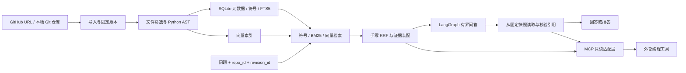

# RepoMind 项目规划与开发日程（v2.1）

> 状态：正式方案，在 v2 架构审查基础上修订。
> 周期：六周，第一周包含 walking skeleton。
> 定位：面向 GitHub 代码仓库的只读理解与分析系统，以固定版本的源码证据回答问题。

## 0. 目标与优先级

用户输入公开 GitHub 仓库 URL 或本地仓库路径后，系统取得固定版本的代码，建立 Python 结构索引、全文索引和向量索引，提供混合检索、自然语言问答及可验证源码引用。证据不足时明确拒答。MCP Server 最终复用同一套只读检索能力。

**主线**：不可变代码快照 → 可解释的检索 → 受版本约束的证据 → 有引用的回答 → 可复现评测。

优先级依次为：① 版本与引用一致性；② 可独立验证的符号、BM25、向量检索和手写 RRF；③ 固定题库与消融；④ 有界的 LangGraph 问答；⑤ 经验证后接入的关系扩展和 MCP。核心算法自己实现，量化指标只填写实测值。

最终交付：可运行的只读系统、固定仓库版本的人工题库、可复跑脚本和原始结果、检索消融表、引用与拒答评测、失败案例及演示。

## 1. 范围与延期条件

### MVP 必须完成

- 公开 GitHub HTTPS URL 与本地**已提交版本**导入；一次问答仅针对一个仓库的一个固定版本。
- Python AST 定义与导入解析；符号、SQLite FTS5/BM25、向量三路检索及手写 RRF。
- 从对应版本读取源码，生成路径和行号引用，并在回答后校验。
- 证据不足拒答；CLI 或最简 HTTP API；固定题库和可复跑评测。

### 有门槛的扩展

| 功能 | 进入主链路的条件 |
|---|---|
| 增量索引 | 全量索引、旧版保留和失败回滚通过验收；报告冷热索引实测。 |
| 一跳关系扩展 | 人工抽检关系边精度，并在同一题库上证明目标题型受益。 |
| MCP Server | 搜索与源码读取接口稳定；先做 `search_symbol`、`read_symbol`。 |
| 最简页面 | CLI/API 与核心评测完成后，再提供仓库选择、搜索、问答、引用跳转。 |

PPR 结构重排、Qdrant、agentic grep/读文件循环、前端美化、跨仓库问答、PR 分析、Wiki 生成、私有仓库认证、LSP、数据流分析和多跳调用链推迟到六周主目标之后。RepoMind 不执行或修改仓库代码，也不提供终端命令执行 Agent；`project2.md` 中的长任务执行与沙箱能力属于另一项目。

## 2. 架构与模块契约

| 模块 | 独立职责与输出 |
|---|---|
| 导入器 | 规范化输入、获得完整 commit ID、保留可读取版本、记录任务状态。 |
| 解析器 | 输入固定文件字节，输出符号、源码跨度、导入与调用表达式；不做通用类型推断。 |
| 词法索引 | 按仓库与版本检索，返回候选 ID、名次与命中理由。 |
| 向量索引 | 记录 embedding 模型与输入版本，返回相同候选 ID 与名次；MVP 用 NumPy 精确扫描。 |
| 融合器 | 手写 RRF，保留每一路名次和最终排序。 |
| 证据读取器 | 只从指定快照读取源码，返回路径、行范围、内容及校验摘要。 |
| 问答图 | 控制检索、装配、生成、校验及一次有界修正；不隐藏检索算法。 |
| MCP 适配层 | 调用已有只读服务，不维护第二套索引。 |

LangGraph 只用于显式状态和条件分支，节点约 4–5 个：检索、装配、生成、校验、拒答/结束。确定性问题路由可用普通函数；不为了凑 Agent 特征加入模型驱动循环。检索、融合和引用校验不得交给框架 retriever。

模型与 embedding 服务通过接口配置。实施时核对官方可用模型名、上下文限制和价格；`.env` 只存本地密钥并加入忽略规则，提交无密钥的 `.env.example`。实验记录模型 ID、参数、日期和实际用量，不预设价格或效果数字。

## 3. 仓库导入、版本管理与索引发布

### 输入与快照

1. MVP 只接受公开 GitHub 仓库 HTTPS URL，规范化 owner/repo 与可选分支；拒绝任意主机、带凭据 URL 与不支持的协议。用参数列表调用 Git，不拼 shell 字符串；设置下载体积、文件数、单文件大小和超时上限。
2. GitHub 导入时先把分支解析为**完整 commit ID**，再读取该 commit 的文件。同步执行 fetch、解析新 commit、构建新索引；commit 未变则结束。分支仅用于跟踪，不作为引用版本。
3. 本地 Git 仓库的 MVP 只索引 `HEAD` 已提交内容；检测到未提交修改时明确提示其不参与索引。非 Git 目录和包含工作树修改的快照方案留待后续，不能把工作树内容误标成 `HEAD`。
4. 保留被索引版本的可读取内容。旧版本在保留期内供引用校验；快照丢失时返回“证据不可验证”，不能回退到当前分支或工作树。GitHub 链接使用完整 commit ID，本地来源使用应用内引用。

筛选时跳过虚拟环境、依赖目录、二进制、生成文件、超大文件与符号链接；记录纳入或跳过原因。README 等文本可进全文索引，不伪装成 Python 符号。导入期间不执行仓库脚本、依赖、钩子、子模块或仓库配置。

### 版本构建与发布

一次索引的身份为 `repo_id + revision_id + index_config_id`。索引配置至少覆盖解析器版本、切分规则、词法规则及 embedding 模型/输入格式。源码未变而配置变化时，应重建受影响的索引。

新版本按 `building → validating → ready → active` 处理。SQLite 元数据与向量后端不能假定共享事务：构建时隔离新版本，检查文件、符号、FTS 与向量引用完整性后，最后切换 `active_revision`。失败记录错误；查询继续读取上一完整版本。问答开始即固定 `revision_id`，同一请求不可跨版本读取。

增量更新先比较文件内容哈希：未变文件复用解析结果；修改或删除文件同步更新符号、chunk、FTS 和向量引用。embedding 缓存键包括**实际送入模型的完整文本、模型 ID 与相关输入配置**，不能仅凭函数体哈希复用。相同 chunk 可以复用 embedding，路径、行号和所属符号仍须按版本独立记录。

## 4. Python AST 与关系边的边界

MVP 支持 Python 模块、类、同步/异步函数、方法、嵌套定义、签名、文档字符串、导入语句与调用表达式。保存限定名、所属文件和源码起止行；展示定义时包含装饰器。解析失败的文件记录诊断，其他文件继续处理。源码编码、解析器版本及 AST 位置缺失情况应明确处理。

AST 能描述**语法上出现了什么**，不能普遍确定 `obj.method()` 的运行时目标。别名、动态导入、猴子补丁、多态和条件定义不在 MVP 通用解析能力内；不得把调用表达式数量称作完整调用图覆盖率。

| 关系状态 | 含义 | 展示规则 |
|---|---|---|
| `resolved` | 明确静态规则得到唯一仓库内目标。 | 展示规则和原表达式，不宣称运行时必然调用。 |
| `ambiguous` | 有多个合理静态候选。 | 展示候选及歧义原因，不画成确定调用链。 |
| `unresolved` | 无可靠仓库内目标或属于动态调用。 | 保留原表达式、位置及失败原因。 |

关系另须区分 `imports` 与 `calls`；反向调用查询只查调用关系。三态描述**已记录表达式的解析结果**，不描述全部真实运行关系。人工标注的精度评测与检索消融都成立后，关系扩展才进入默认问答路径；最多一跳。

## 5. 检索、融合、证据与问答

### 检索

- **统一候选粒度**：以可定位代码 chunk 为融合单位；符号搜索映射到对应 chunk。每项保留仓库、版本、路径、行范围、各路名次和命中理由。
- **符号路**：精确名称、限定名及拆词匹配，覆盖“这个函数在哪里”类问题。
- **BM25 路**：用 SQLite FTS5 检索代码与选定文本。测试 `snake_case`、`CamelCase`、限定名和路径的分词；查询先限定目标版本，再取该版本 Top-K，避免全库截断后过滤。FTS5 `bm25()` 数值越小越好；采用 external-content 表时必须验证索引同步。
- **向量路**：按符号/函数切分，长定义再拆成可引用子段；记录 embedding 输入与模型版本。先用 NumPy 相似度扫描，实测出现性能瓶颈后才考虑专用向量库。
- **RRF**：手写 `Σ 1/(k + rank)`，不直接混合 BM25 与余弦分数；固定候选数、`k` 与并列排序规则，在开发集选参，测试集只用于最终报告。

FTS5 的全局词频统计可能随其他版本加入而变化；正式对照实验使用冻结的索引快照，记录数据库及索引配置。所有消融采用相同题库、版本、候选预算和评分规则。

### 证据与回答

检索结果只是候选。装配上下文时从固定快照重读源码，按 token 预算保留路径、行号与证据段。回答采用结构化结论与引用；每个关键结论必须绑定一个或多个证据段。

引用记录 `repo_id + revision_id + path + start_line + end_line + evidence_hash`。回答后检查版本可读、文件存在、范围有效、该范围源码与提供给模型的证据一致。不通过最多修正一次，仍失败则删除该结论或拒答。**程序校验只能证明引用指向的源码正确，不能证明源码在语义上支持结论**；支持率用人工标注评测，LLM 只能辅助抽检。

无足够证据、目标不明确，或只有 `ambiguous/unresolved` 关系可支撑确定性调用链时，说明限制或拒答。拒答阈值和提示词在开发集确定，不按测试集逐题调整。仓库源码属于不可信输入，其中的指令不能覆盖系统规则。

## 6. 数据模型与接口

| 实体 | 必要字段或约束 |
|---|---|
| `repositories` | `id`, 来源类型, 规范化来源, 跟踪分支, `active_revision_id` |
| `revisions` | `id`, `repo_id`, 完整 commit ID, `index_config_id`, 状态, 建立时间, 快照位置 |
| `files` | `revision_id`, 相对路径, 内容哈希, 语言, 筛选/解析状态 |
| `symbols` | `revision_id`, `file_id`, 限定名, 类型, 签名, 源码起止行 |
| `chunks` | `revision_id`, `file_id`, 可选 `symbol_id`, 起止行, 内容哈希, embedding 输入哈希, 向量引用 |
| `relations` | 源表达式位置, 关系类型, 解析状态, 可选目标/候选, 解析规则与原因 |
| `index_jobs` | `repo_id`, 目标版本, 阶段, 进度, 错误 |

最小只读服务契约：`import_repository`、`sync_repository`、`search`、`read_source`、`ask`、`job_status`。HTTP 与 MCP 只适配这些服务，不分别实现业务逻辑。HTTP 可提供导入、同步、任务状态、搜索、问答和源码读取端点。MCP 首批提供 `search_symbol`、`read_symbol`；`list_symbols_in_file` 可随首批加入；`find_callers` 须携带解析状态并在关系质量验收后开放。MCP 用 stdio，工具输出含仓库版本及引用。

## 7. 可复现评测与消融

### 题库与协议

第 1 周标注 10–15 题；第 3 周约 30 题，覆盖 2–3 个固定 commit 的公开 Python 仓库；第 6 周视质量和进度扩至 40–60 题。每题保存问题、仓库与 commit、类型、一个或多个金标准符号/证据范围、无答案标记及人工判定说明。类型包括符号定位、自然语言功能定位、跨文件流程和无答案题。

LLM 可起草题目，金标准必须人工核对。开发题用于切分、分词、RRF 参数和拒答阈值；锁定测试题用于最终报告。保存题库版本、代码版本、索引配置、模型 ID、prompt 版本、Top-K、随机性设置和日期，并提交逐题原始结果及失败分类。题库较小时同时报告分子/分母，避免将波动当稳定提升。

| 指标 | 定义与注意事项 |
|---|---|
| Recall@5 / MRR | 按金标准符号或证据范围计算，多答案命中规则事先固定。 |
| 引用机械有效率 | 路径、版本、行范围及源码哈希一致，由程序和 CI 检查。 |
| 引用支持率 | 人工判断证据是否支撑结论，报告样本数与分歧处理。 |
| 无答案题拒答正确率 | 在无答案子集计算，同时报告有答案题的错误拒答率。 |
| 延迟与成本 | 分开记录索引、检索、生成的 p50/p95；记录实际 token、embedding 调用及实付费用。 |
| 增量收益 | 固定仓库与单文件改动，比较冷热耗时、重算 chunk 数和 embedding 调用数。 |
| 关系精度 | 对人工抽检的 `resolved` 边计算正确数/抽检数，并列出歧义与未解析原因。 |

消融顺序：① 符号 + BM25；② 仅向量；③ 三路 RRF；④ 三路 RRF + 一跳关系扩展（关系质量达标后）。PPR 与 agentic 循环仅作为六周后的独立实验。各组统一题库、版本、候选预算和评分脚本；报告总分、按题型分数、逐题差异及代表性失败案例，不预填提升百分比。每周五保留一次评测快照。

## 8. 六周开发路线

| 周 | 工作重点 | 周末交付与验收证据 |
|---|---|---|
| **第 1 周** | Walking skeleton：固定 GitHub commit、本地 `HEAD`、文件筛选、AST 最小符号提取、CLI 符号搜索；定义题库和评分格式。 | 一个公开仓库完成“导入 → 解析 → 搜索 → 展示该 commit 源码与行号”；10–15 道人工题及首版逐题分数。 |
| **第 2 周** | SQLite 版本/文件/符号模型、FTS5/BM25、符号切分、版本隔离；扩展到 2–3 个仓库。 | 符号与 BM25 各自跑分；新版本构建失败或同步中，旧版仍可查。 |
| **第 3 周** | 向量检索、统一候选 ID、手写 RRF、检索日志；题库约 30 题。 | 三组检索对照，保存每题 Top-K、命中原因及失败分析。 |
| **第 4 周** | 固定快照读取、LangGraph 有界问答、结构化引用校验、拒答；最简 API/页面按余量实现。 | 正确回答、错误引用拦截、证据不足拒答各有演示；人工抽检引用支持率。 |
| **第 5 周** | 文件级增量索引、embedding 复用、失败回滚；一跳三态关系作为实验分支。 | 冷热索引实测，失败后旧版不受影响；关系抽检精度与目标题型消融。 |
| **第 6 周** | 锁定题库与配置、完整实测、README、决策记录和演示；核心服务稳定后接 MCP 薄适配层。 | 可复跑脚本、原始结果、汇总表与失败案例；MCP 客户端可调用搜索和源码读取。 |

若进度受限，优先保证版本一致的检索、可验证引用和可复现评测；减少题库规模与 UI 工作量，推迟关系扩展和 MCP。不得为交付数量牺牲数据真实性或把未验证调用关系作为事实。

## 9. MVP 验收与第一周任务

### MVP 验收

- 相同 commit 与索引配置重复构建，文件、符号及 chunk 定位结果一致。
- 查询全程绑定一个版本；同步失败不影响旧版；成功后只发布完整新版本。
- 每条引用能在对应快照中重读并通过路径、行范围及哈希验证；故意篡改时校验失败。
- 固定题库含四类问题，三组检索实验使用相同设置，报告 Recall@5、MRR、引用支持率与拒答指标的实测结果。
- 无足够证据时明确拒答；所有对外数字附仓库 commit、题库版本、索引/模型配置与日期。

验收关注正确性、可复跑性和诚实呈现，不预设尚未测出的准确率、延迟或节省比例。

### 第一周独立完成的七项任务

1. 选择一个可控的公开 Python 仓库，固定 URL、分支与完整 commit；另备小型本地 Git 仓库验证同步及错误场景。
2. 写清导入契约：URL 范围、文件和时间上限、忽略规则、本地未提交修改提示、快照保留及失败状态。
3. 定义最小模型：版本、文件、符号、源码跨度及索引任务，明确 ID 不跨版本误用。
4. 解析模块、类、同步/异步函数、方法、嵌套定义、签名、文档字符串和行号；记录语法错误。
5. 建立 CLI 链路：导入固定 commit → 列出符号 → 按名称搜索 → 展示该版本源码与行号。
6. 人工标注 10–15 题，至少两题无答案；保存目标符号/证据及判定说明。
7. 运行并保存首版逐题评分。第一周要求链路可信、能测量，不要求 LLM 问答或前端。

## 10. 文档、展示与边界

README 最终说明定位、支持的输入、固定版本与引用语义、运行方式、模块架构、实验复现方法、实测数字及失败案例。简历中的提升幅度、成本和性能数据必须从提交的原始实验结果计算。外部 embedding/LLM 服务可能接收代码片段，需在界面和文档中说明；本地仓库只用于用户明确选择的分析任务。

历史调研中的 star 数、竞品状态、API 型号/价格和论文基准随时间变化，不能作为本项目技术正确性的依据。实施相关依赖时查官方文档，实验结论以本项目固定版本的实测为准。

### 参考资料

- [Python `ast` 文档](https://docs.python.org/3/library/ast.html)：源码位置与语法节点边界。
- [SQLite FTS5 文档](https://www.sqlite.org/fts5.html)：BM25 排序与索引一致性。
- [Git clone](https://git-scm.com/docs/git-clone) / [Git show](https://git-scm.com/docs/git-show)：固定版本获取与源码对象读取。
- [RRF 原论文](https://cormack.uwaterloo.ca/cormacksigir09-rrf.pdf)：排名融合方法。
- [LangGraph 官方文档](https://docs.langchain.com/oss/python/langgraph/overview)：有界工作流编排。
- [MCP 工具规范](https://modelcontextprotocol.io/specification/2025-11-25/server/tools)：只读工具接口。
